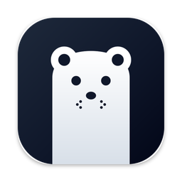
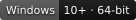

<p align="center">
  <a href="https://business.tabtasker.com" target="_blank" rel="noopener noreferrer">
    
  </a>
</p>

<h1 align="center">TabTasker Business</h1>

<p align="center">
  <strong>Chat, tasks, CRM, documents, whiteboards, calls and AI agents for your team.</strong><br>
  Together in one desktop app.
</p>

<p align="center">
  <a href="https://github.com/vehicularis/tabtasker-business-releases/releases/latest/download/TabTasker-Business-mac-arm64.dmg"><strong>Download for Mac</strong></a><br>
  For Apple silicon, on macOS 13 or later.
  On Windows, get it from the <a href="https://apps.microsoft.com/detail/9MVBXHSCJXC4">Microsoft Store</a>.
</p>

<p align="center">
  
  <a href="https://apps.microsoft.com/detail/9MVBXHSCJXC4"></a>
</p>

This repository is where the Mac app is published. Each release has the DMG you install, the update the
installed apps download, and the checksums for both. The app's source code isn't public.

## Download

| Platform | Requires | Get it |
| --- | --- | --- |
| macOS, Apple silicon | macOS 13 or later | [TabTasker-Business-mac-arm64.dmg](https://github.com/vehicularis/tabtasker-business-releases/releases/latest/download/TabTasker-Business-mac-arm64.dmg) |
| Windows, 64-bit | Windows 10 or later | [Microsoft Store](https://apps.microsoft.com/detail/9MVBXHSCJXC4) |

Every Mac version, with what changed in it, is on the [releases page](https://github.com/vehicularis/tabtasker-business-releases/releases).

## Install

Open the DMG and drag TabTasker Business into Applications. Then open it and sign in with your
[business.tabtasker.com](https://business.tabtasker.com) account.

It's signed with the Developer ID of Vehicularis Limited and notarized by Apple, so it opens without a warning.

On Windows, install it from the [Microsoft Store](https://apps.microsoft.com/detail/9MVBXHSCJXC4). The Store
keeps it up to date.

## Updates

From 0.1.2 on, the Mac app updates itself. It looks for a new version when it opens, every few hours while it
runs, and when you choose TabTasker Business › Check for Updates…. A new version downloads in the background,
and the app checks that we signed it before installing it. It's ready the next time you restart the app, and
the menu item changes to Restart to Update. The app never restarts on its own.

Versions before 0.1.2 can't update themselves. Download the latest release once and replace the app with it.

## Verify a download

Each release has a `checksums.txt` with the SHA-256 of every file in it. Download it to the folder the DMG is
in, then check the DMG's checksum and ask Gatekeeper about it:

```sh
cd ~/Downloads
shasum -a 256 -c checksums.txt --ignore-missing                # TabTasker-Business-mac-arm64.dmg: OK
spctl -a -vv -t install TabTasker-Business-mac-arm64.dmg       # accepted, source=Notarized Developer ID
```

`origin=` on the last line names Vehicularis Limited. If your browser renamed the DMG, for example to
`TabTasker-Business-mac-arm64 (1).dmg`, rename it back first, or `shasum` won't find it.

## Questions

### Does it run on an Intel Mac or on Linux?

No, there's only an Apple silicon build for the Mac, and there's no Linux build. Use TabTasker Business in your
browser at [business.tabtasker.com](https://business.tabtasker.com) instead.

### Is my work stored on my Mac?

Your workspace's chats, tasks, documents and files are on business.tabtasker.com, so they're the same in the app,
in your browser and on your other devices. The app keeps its settings, stickies, downloaded voice models and its
built-in browser's profile on your Mac.

### Where do I find the version I have?

Select TabTasker Business in Applications and choose File › Get Info.

## Uninstall

Quit TabTasker Business from its menu bar icon. If Launch at Login is checked in that menu, uncheck it first.
Then move the app from Applications to the Trash.

What it keeps on your Mac is in these folders. Delete them to remove that too:

- `~/Library/Application Support/com.tabtasker.business.desktop`
- `~/Library/Caches/com.tabtasker.business.desktop`
- `~/Library/WebKit/com.tabtasker.business.desktop`

Deleting the app doesn't delete your account or anything in your workspace.

## Help

Questions and problems: [business.tabtasker.com/contact](https://business.tabtasker.com/contact).
Report a security problem privately, as [SECURITY.md](SECURITY.md) explains.

[Terms](https://business.tabtasker.com/terms) · [Privacy](https://business.tabtasker.com/privacy)

© Vehicularis Limited. All rights reserved.
